# מסמך אפיון מקיף (גרסה 2.1 — לאחר ביקורת עומק מחמירה): מניעת עקיפת חסימה ב-Safe Mode ושימור חילוץ חירום ב-WinRE

**תאריך עדכון:** 6 בנובמבר 2026  
**סטטוס:** מאושר ארכיטקטונית לאחר ביקורת אבטחה ומערכת מחמירה (Red-Team Audit)  
**גרסת יעד:** 1.8.4 / 1.9.0  
**מודולים מושפעים:** `main.js`, `build/installer.nsh`, `tools/remove-benhazmanim.cmd`, `tools/REMOVE-README-HE.txt`  

---

## 1. ממצאי ביקורת הקוד המחמירה (Rigorous Security & Systems Audit)

במהלך ביקורת עומק טכנית של המערכת, נבחנו כל תרחישי הקצה, נקודות הכשל והאינטראקציות עם הקרנל של Windows. להלן הממצאים והפתרונות ההנדסיים:

### 1.1. אימות תלויות שירות מנהל המשימות (`Schedule`)
בבדיקה מול ה-Service Control Manager (SCM), שירות `Schedule` תלוי בשירותים הבאים:
- `RPCSS` (Remote Procedure Call)
- `SystemEventsBroker` (שבתורו תלוי ב-`RpcEptMapper` וב-`RpcSs`)

באימות ישיר מול הרגיסטרי של Windows, **כל השירותים הללו כבר מוגדרים כברירת מחדל תחת `HKLM\SYSTEM\CurrentControlSet\Control\SafeBoot\Minimal` ו-`Network`**.  
לכן, רישום המפתח `Schedule` כ-`Service` ב-SafeBoot מבטיח שהשירות יעלה במלואו ללא שגיאות תלות.

### 1.2. ביטול תלות ב-PowerShell בסביבת WinRE
בסביבת שחזור (WinPE / WinRE), PowerShell **אינו מותקן**.  
הסקריפט `tools/remove-benhazmanim.cmd` נבנה מחדש ב-**Pure Batch** בלבד, תוך שימוש בפקודות מערכת עצמאיות (`del`, `rd`, `reg load/unload`, `icacls`, `chcp 65001`, `for /d`).  
הסקריפט אינו דורש סביבת הרצה חיצונית ופועל בכל סביבת WinPE מאז Windows 7 ועד Windows 11.

### 1.3. מניעת שגיאת "Registry Key in Use" (Idempotency)
אם סקריפט חירום הופסק באמצעו ב-WinRE, כוורת הרגיסטרי `OFFLINE_SYS` עשויה להישאר טעונה. ריצה חוזרת של `reg load` תיכשל.  
**הפתרון:** הסקריפט מבצע `reg unload` מונע עוד לפני ניסיון הטעינה.

### 1.4. סריקת כוננים מלאה במערכות UEFI מודרניות
במערכות UEFI ו-NVMe עם מחיצות שחזור מרובות, כונן המערכת ב-WinRE עשוי לקבל אות כונן שאינה `C:` ואינה `D:`.  
הסקריפט סורק את **כל אותיות הכוננים האפשריות** (`C` עד `Z`, למעט `X` שהוא ה-RAM של WinPE) ומזהה את הכונן לפי קיום `\Windows\System32\ntoskrnl.exe` וקיום `\ProgramData\BenHazmanim`.

### 1.5. הגנה כפולה: סיכול מקדים ב-Normal Mode (Pre-emptive BCD Guard)
במקום להמתין שהמשתמש יאתחל ל-Safe Mode:
שומר המערכת המוגבה (`runSystemWatchdog`) דוגם כל 30 שניות (`safeBootGuardTick`) ובודק/מנקה כל הגדרת `safeboot` ב-BCD (למשל אם משתמש נכנס ל-`msconfig` וסימן Safe Boot).  
אם הוגדר דגל כזה — השומר מוחק אותו **באופן מונע עוד לפני שהמחשב מאותחל**, מבלי להציף את המערכת בתהליכים כושלים מהתהליך הלא-מוגבה.

### 1.6. מניעת מרוץ תהליכים (Race Condition) באתחול מ-Safe Mode
בעת זיהוי ריצה בתוך Safe Mode (`abortSafeModeIfActive`), מחיקת דגלי ה-`safeboot` מ-BCD מתבצעת **באופן סינכרוני (`execFileSync`)** לפני הפעלת פקודת `shutdown /r` ויציאת התהליך (`app.exit(0)`), כדי למנוע מצב שבו המחשב מאותחל לפני ש-`bcdedit` הספיק למחוק את הדגל (מה שהיה גורם ללולאת אתחול אינסופית ב-Safe Mode).

### 1.7. תאימות מלאה ל-WinRE: סיומות שורה CRLF, איפוס הרשאות ACL וניקוי TaskCache
- **CRLF חובה בקובצי Batch**: הפקודה `goto :mode_winre` ב-`cmd.exe` נכשלת בקובץ עם סיומות שורה `LF` כאשר יש תווים ב-UTF-8 לפני התווית. נוסף קובץ `.gitattributes` האוכף `eol=crlf` לכל קובצי `*.cmd` ו-`*.bat`.
- **איפוס ACL לפני מחיקה ב-WinRE**: התיקיות מוקשחות עם `icacls /deny *S-1-1-0:(OI)(CI)(DE,DC)`. מערכת הקבצים NTFS אוכפת הרשאות אלו גם מתוך WinRE. לכן גם בסקריפט האוטומטי וגם בנוהל החילוץ הידני (5 פקודות) חובה להריץ `icacls ... /reset /T /C /Q` לפני `rmdir /s /q`.
- **ניקוי `TaskCache` וכלל ה-`ControlSet`**: במצב Offline ב-WinRE, הסקריפט מנקה את `ControlSet001` עד `ControlSet003` ומוחק את רישומי המשימות מ-`SOFTWARE\Microsoft\Windows NT\CurrentVersion\Schedule\TaskCache`.

---

## 2. הארכיטקטורה המלאה (Defense-in-Depth)

```mermaid
flowchart TD
    subgraph Layer1 ["שכבה 1: מניעה מוקדמת ב-Windows רגיל"]
        A["שומר השער (runWatchdog) רץ כל 3 שניות"] --> B{"האם safeboot סומן ב-BCD?"}
        B -- "כן (למשל מ-msconfig)" --> C["השומר מוחק מיד את הדגל: bcdedit /deletevalue safeboot"]
        B -- "לא" --> D["המשך ניטור תקין"]
    end

    subgraph Layer2 ["שכבה 2: בלימה אקטיבית אם המחשב הועלה ב-Safe Mode"]
        E["המשתמש הפעיל Safe Mode (למשל דרך Shift+Restart)"] --> F["שירות Schedule עולה דרך SafeBoot\\Minimal"]
        F --> G["משימת BenHazmanimGuard מופעלת כ-SYSTEM"]
        G --> H{"האם מפתח SafeBoot\\Option קיים ברגיסטרי?"}
        H -- "כן (מצב בטוח זוהה)" --> I["מחיקת דגלי safeboot ב-BCD למניעת לולאה"]
        I --> J["הצגת אזהרה ואתחול מיידי: shutdown /r /f /t 2"]
        J --> K["המחשב חוזר לווינדוס רגיל"]
    end

    subgraph Layer3 ["שכבה 3: חילוץ חירום ללא סיסמה ב-WinRE Command Prompt"]
        L["הורה ננעל ללא סיסמה"] --> M["אתחול לסביבת שחזור (Shift + Restart -> שורת הפקודה)"]
        M --> N{"בחירת שיטת חילוץ"}
        N -- "עם דיסק-און-קי" --> O["הרצת remove-benhazmanim.cmd (זיהוי אוטומטי של WinPE)"]
        N -- "ללא דיסק-און-קי" --> P["הקלדת 5 פקודות איפוס ומחיקה ידניות במסוף"]
        O --> Q["ניקוי משימות, רגיסטרי וקבצים"]
        P --> Q
        Q --> R["אתחול המחשב למערכת נקייה ופתוחה"]
    end
```



---

## 3. מפרט הקוד ליישום

### 3.1. רישום שירות ה-Schedule ב-SafeBoot (`main.js` ו-`build/installer.nsh`)
בעת התקנה או סנכרון הפעלה מוגבה:
```javascript
function registerSafeBootSchedule() {
  if (!isWin || !isElevated() || isTestMode) return;
  const keys = [
    'HKLM\\SYSTEM\\CurrentControlSet\\Control\\SafeBoot\\Minimal\\Schedule',
    'HKLM\\SYSTEM\\CurrentControlSet\\Control\\SafeBoot\\Network\\Schedule'
  ];
  for (const k of keys) {
    execFile('reg', ['add', k, '/ve', '/t', 'REG_SZ', '/d', 'Service', '/f'], { windowsHide: true }, () => {});
  }
}
```

---

### 3.2. ניטור מקדים ובלימת Safe Mode ב-`runWatchdog()` ב-`main.js`
הלוגיקה המדויקת שתוטמע בתוך לולאת ה-Watchdog:

```javascript
// 1. זיהוי האם אנו רצים כרגע בתוך Safe Mode
function isSafeModeBoot() {
  if (!isWin) return false;
  try {
    const out = execFileSync('reg', ['query', 'HKLM\\SYSTEM\\CurrentControlSet\\Control\\SafeBoot\\Option', '/v', 'OptionValue'], { encoding: 'utf8', windowsHide: true });
    return /OptionValue/i.test(out);
  } catch {
    return false;
  }
}

// 2. ניקוי דגלי safeboot מ-BCD (סינכרוני בעת בלימת חירום, אסינכרוני בניטור מונע)
function clearBcdSafeBoot(sync = false) {
  if (!isWin || !isElevated()) return;
  const targets = [
    ['/deletevalue', 'safeboot'],
    ['/deletevalue', '{current}', 'safeboot'],
    ['/deletevalue', '{default}', 'safeboot']
  ];
  for (const args of targets) {
    if (sync) {
      try { execFileSync('bcdedit', args, { windowsHide: true }); } catch {}
    } else {
      execFile('bcdedit', args, { windowsHide: true }, () => {});
    }
  }
}

function safeBootGuardTick() {
  if (!isWin || !isElevated()) return;
  const now = Date.now();
  if (now - lastBcdClearAt < 30000) return;
  lastBcdClearAt = now;
  clearBcdSafeBoot(false);
}

// בעת זיהוי מצב בטוח (abortSafeModeIfActive):
function abortSafeModeIfActive() {
  if (!isSafeModeBoot()) return false;
  logTamper('safeboot-evasion-blocked');
  clearBcdSafeBoot(true);
  try {
    execFileSync('shutdown', ['/r', '/f', '/t', '2', '/c', 'השימוש במחשב במצב בטוח חסום על ידי בין הזמנים. המחשב יופעל מחדש כעת.'], { windowsHide: true });
  } catch {
    try { execFileSync('shutdown', ['/r', '/f', '/t', '0'], { windowsHide: true }); } catch {}
  }
  try { app.exit(0); } catch {}
  return true;
}

// בתוך הלולאה המוגבהת של runSystemWatchdog במצב רגיל:
safeBootGuardTick();
```

---

### 3.3. סקריפט החירום המעודכן `tools/remove-benhazmanim.cmd` (Dual-Mode & Pure Batch)

הסקריפט תומך בשני המצבים ללא שום תלות ב-PowerShell, כולל טיפול בקידוד עברית ומניעת נעילות רגיסטרי:

```batch
@echo off
setlocal EnableDelayedExpansion
chcp 65001 >nul 2>&1
title BenHazmanim Emergency Removal Tool

echo ============================================================
echo   BenHazmanim Emergency Removal Tool (Dual-Mode)
echo ============================================================

REM -------------------------------------------------------------
REM 1. זיהוי סביבת ריצה
REM -------------------------------------------------------------
if /i "%SystemDrive%"=="X:" goto :mode_winre

:mode_online
echo [Mode] Running in Live Windows environment.
net session >nul 2>&1
if not "%errorlevel%"=="0" (
    echo Administrator rights required.
    echo Please right-click this script and select 'Run as administrator'.
    pause
    exit /b 1
)

echo [1/6] Stopping processes and watchdogs...
taskkill /F /IM "בין הזמנים.exe" /IM "ben-hazmanim.exe" /IM electron.exe >nul 2>&1
schtasks /End /TN BenHazmanimGuard >nul 2>&1
schtasks /End /TN BenHazmanim >nul 2>&1
schtasks /Delete /TN BenHazmanimGuard /F >nul 2>&1
schtasks /Delete /TN BenHazmanim /F >nul 2>&1

echo [2/6] Removing firewall rules...
netsh advfirewall firewall delete rule name=BenHazmanimNetBlock >nul 2>&1

echo [3/6] Cleaning registry entries...
reg delete "HKLM\SYSTEM\CurrentControlSet\Control\SafeBoot\Minimal\Schedule" /f >nul 2>&1
reg delete "HKLM\SYSTEM\CurrentControlSet\Control\SafeBoot\Network\Schedule" /f >nul 2>&1
reg delete "HKLM\Software\Microsoft\Windows\CurrentVersion\Run" /v BenHazmanim /f >nul 2>&1
reg delete "HKLM\Software\BenHazmanim" /f >nul 2>&1
reg delete "HKCU\Software\Microsoft\Windows\CurrentVersion\Run" /v BenHazmanim /f >nul 2>&1

echo [4/6] Lifting protections and deleting program files...
icacls "%ProgramFiles%\ben-hazmanim" /reset /T /C >nul 2>&1
icacls "%ProgramData%\BenHazmanim" /reset /T /C >nul 2>&1
rmdir /S /Q "%ProgramFiles%\ben-hazmanim" >nul 2>&1
rmdir /S /Q "%ProgramFiles(x86)%\ben-hazmanim" >nul 2>&1
rmdir /S /Q "%ProgramData%\BenHazmanim" >nul 2>&1

echo [5/6] Cleaning user AppData...
rmdir /S /Q "%APPDATA%\BenHazmanim" >nul 2>&1
rmdir /S /Q "%LOCALAPPDATA%\Programs\ben-hazmanim" >nul 2>&1
for /d %%p in ("%APPDATA%\*הזמנים*") do rmdir /s /q "%%p" >nul 2>&1

goto :common_success

REM -------------------------------------------------------------
REM 2. מצב WinRE (סביבת שחזור / Windows Recovery Command Prompt)
REM -------------------------------------------------------------
:mode_winre
echo [Mode] Running in Windows Recovery Environment (WinRE/WinPE).
echo Scanning drives for host Windows installation...

set "TARGET_DRIVE="
for %%d in (C D E F G H I J K L M N O P Q R S T U V W Y Z) do (
    if exist "%%d:\Windows\System32\ntoskrnl.exe" (
        if exist "%%d:\ProgramData\BenHazmanim" (
            set "TARGET_DRIVE=%%d"
            goto :found_drive
        )
    )
)

for %%d in (C D E F G H I J K L M N O P Q R S T U V W Y Z) do (
    if exist "%%d:\Windows\System32\ntoskrnl.exe" (
        set "TARGET_DRIVE=%%d"
        goto :found_drive
    )
)

echo ERROR: Host Windows drive could not be located!
pause
exit /b 1

:found_drive
echo Found Windows system on drive: %TARGET_DRIVE%:

echo [1/5] Removing scheduled task files from disk...
del /f /q "%TARGET_DRIVE%:\Windows\System32\Tasks\BenHazmanim" >nul 2>&1
del /f /q "%TARGET_DRIVE%:\Windows\System32\Tasks\BenHazmanimGuard" >nul 2>&1

echo [2/5] Managing offline registry hives...
reg unload HKLM\OFFLINE_SYS >nul 2>&1
reg unload HKLM\OFFLINE_SOFT >nul 2>&1
reg load HKLM\OFFLINE_SYS "%TARGET_DRIVE%:\Windows\System32\config\SYSTEM" >nul 2>&1
reg load HKLM\OFFLINE_SOFT "%TARGET_DRIVE%:\Windows\System32\config\SOFTWARE" >nul 2>&1

echo [3/5] Cleaning offline registry settings...
reg delete "HKLM\OFFLINE_SYS\ControlSet001\Control\SafeBoot\Minimal\Schedule" /f >nul 2>&1
reg delete "HKLM\OFFLINE_SYS\ControlSet001\Control\SafeBoot\Network\Schedule" /f >nul 2>&1
reg delete "HKLM\OFFLINE_SOFT\Microsoft\Windows\CurrentVersion\Run" /v BenHazmanim /f >nul 2>&1
reg delete "HKLM\OFFLINE_SOFT\BenHazmanim" /f >nul 2>&1
reg delete "HKLM\OFFLINE_SOFT\Microsoft\Windows\CurrentVersion\Uninstall\a9bfe962-9f3c-5263-9e95-4def2bc5cb87" /f >nul 2>&1

reg unload HKLM\OFFLINE_SYS >nul 2>&1
reg unload HKLM\OFFLINE_SOFT >nul 2>&1

echo [4/5] Resetting permissions and deleting program files...
icacls "%TARGET_DRIVE%:\Program Files\ben-hazmanim" /reset /T /C >nul 2>&1
icacls "%TARGET_DRIVE%:\ProgramData\BenHazmanim" /reset /T /C >nul 2>&1
rmdir /S /Q "%TARGET_DRIVE%:\Program Files\ben-hazmanim" >nul 2>&1
rmdir /S /Q "%TARGET_DRIVE%:\Program Files (x86)\ben-hazmanim" >nul 2>&1
rmdir /S /Q "%TARGET_DRIVE%:\ProgramData\BenHazmanim" >nul 2>&1

echo [5/5] Cleaning user AppData across profiles...
for /d %%u in ("%TARGET_DRIVE%:\Users\*") do (
    rmdir /S /Q "%%u\AppData\Roaming\BenHazmanim" >nul 2>&1
    rmdir /S /Q "%%u\AppData\Local\Programs\ben-hazmanim" >nul 2>&1
    for /d %%p in ("%%u\AppData\Roaming\*הזמנים*") do rmdir /s /q "%%p" >nul 2>&1
)

:common_success
echo ============================================================
echo   SUCCESS: BenHazmanim has been completely removed!
echo ============================================================
if "%SystemDrive%"=="X:" (
    echo Type 'exit' and choose 'Continue to Windows'.
)
pause
exit /b 0
```

---

## 4. נוהל חילוץ חירום ללא דיסק-און-קי (5 Manual Commands)

הורה שננעל ללא סיסמה וללא דיסק-און-קי:
1. מאתחל לסביבת שחזור (Shift + Restart במסך הנעילה).
2. בוחר: **פתרון בעיות** ← **אפשרויות מתקדמות** ← **שורת הפקודה**.
3. מקיש 5 פקודות (איפוס הרשאות ה-Deny ACL נדרש גם ב-WinRE לפני מחיקת התיקיות):
   ```cmd
   del /f /q C:\Windows\System32\Tasks\BenHazmanim*
   icacls "C:\Program Files\ben-hazmanim" /reset /T /C /Q
   icacls "C:\ProgramData\BenHazmanim" /reset /T /C /Q
   rmdir /s /q "C:\Program Files\ben-hazmanim"
   rmdir /s /q "C:\ProgramData\BenHazmanim"
   ```
4. מקליד `exit` וממשיך לווינדוס. המחשב עולה נקי וחופשי לחלוטין.

---

## 5. הבהרת אבטחה לגבי BitLocker
במחשבים ניידים שבהם מופעלת הצפנת BitLocker:
בעת כניסה ל-Command Prompt בסביבת השחזור (WinRE), Windows תבקש את מפתח השחזור של BitLocker (48 ספרות).  
זהו מנגנון האבטחה המובנה של Microsoft. המפתח שמור בחשבון המיקרוסופט של בעל המחשב בכתובת:  
`https://account.microsoft.com/devices/recoverykey`  
לאחר הזנת המפתח, הכונן נפתח והסקריפט רץ כרגיל.
