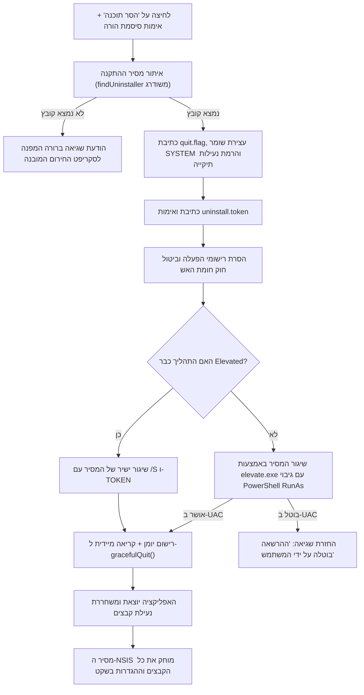

# מסמך אפיון: פתרון שורשי לכשל בהסרת התוכנה מתוך הממשק (חלק ב')

**תאריך יצירה:** 5 בנובמבר 2026  
**סטטוס:** מאופיין לקראת ביצוע  
**גרסת יעד:** 1.8.2 (תיקון פנימי) / 1.8.3  
**מודולים מושפעים:** `main.js`, `build/installer.nsh`, `renderer/app.js`

---

## 1. רקע ומטרת המסמך

משתמשים דיווחו כי בעת לחיצה על כפתור "הסרת התוכנה מהמחשב" במסך ההגדרות והזנת סיסמת ההורה, התוכנה מציגה שגיאה ולא מצליחה להסיר את עצמה:
> *"לא ניתן היה להפעיל את מסיר ההתקנה. אשרו את בקשת ההרשאות של Windows (UAC) ונסו שוב."*

מסמך זה מאפיין חקירה שורשית של התקלה ומגדיר פתרון מלא, מקצועי ועמיד שאינו תלוי ברכיבי מערכת שבריריים ב-Windows.

---

## 2. חקירת שורש התקלה (Root Cause Analysis)

### 2.1. שרשרת הכשל שמתרחשת בפועל
1. המשתמש מזין סיסמת הורה תקינה ולוחץ על אישור ההסרה.
2. התהליך הראשי (`main.js` ב-`app:uninstall`) מבצע הכנה להסרה (מנטרל שומרים, רושם `quit.flag`, ויוצר `uninstall.token`).
3. התוכנה מנסה להפעיל את תוכנית ההסרה של NSIS (`Uninstall בין הזמנים.exe`) בהרשאות מנהל דרך `launchElevated`.
4. הפונקציה `launchElevated` נכנסת ללולאת המתנה של 25 שניות ובודקת האם התהליך רץ, באמצעות הפונקציה `processRunningByName("Uninstall בין הזמנים.exe")`.
5. **הבדיקה נכשלת באופן עקבי:**
   - **קריסת פקודת `tasklist`:** הפקודה `tasklist /FI "IMAGENAME eq ..."` מסתמכת על WMI (מאגר ה-CIM של Windows). במחשבים שבהם מאגר ה-WMI אינו תקין (תופעה נפוצה ב-Windows 10/11), הפקודה קורסת עם השגיאה `ERROR: Invalid class` ומחזירה תמיד `false`.
   - **אי-תאימות לקידוד עברית:** `tasklist.exe` מופעלת בסביבת קונסול ANSI/OEM, והשוואת שמות קבצים בעברית נכשלת או משתבשת.
   - **ארכיטקטורת מסיר ההתקנה של NSIS:** תוכנית ההסרה של NSIS מעתיקה את עצמה לתיקיית `%TEMP%` (בשם `Au_.exe`), מפעילה את העותק הזמני, **וסוגרת מיד את התהליך הראשי (`Uninstall בין הזמנים.exe`) בתוך פחות מ-200 מילי-שניות** כדי לאפשר את מחיקת הקובץ עצמו מ-`Program Files`. לכן, גם במערכת עם WMI תקין, הבדיקה אינה מוצאת את התהליך המקורי לאחר 500 מילי-שניות!
6. **התוצאה ההרסנית:**
   - בתום 25 שניות מוחזרת שגיאה: `"לא ניתן היה להפעיל את מסיר ההתקנה..."`.
   - התוכנה **אינה קוראת ל-`gracefulQuit()`** ונשארת פתוחה ופועלת.
   - קבצי התוכנה (`בין הזמנים.exe`, `app.asar`) נשארים נעולים בזיכרון על ידי Windows.
   - העותק הזמני של המסיר ב-Temp אינו מצליח למחוק את התיקייה התפוסה, ותהליך ההסרה נכשל לחלוטין.

### 2.2. חוסרים באיתור מסיר ההתקנה (`findUninstaller`)
- הפונקציה `findUninstaller()` אינה מחפשת באופן ישיר בנתיבי ההתקנה הקבועים של 64/32 ביט:
  - `C:\Program Files\ben-hazmanim`
  - `C:\Program Files (x86)\ben-hazmanim`
- הפונקציה מחפשת ב-`HKCU` בעוד שההתקנה היא ברמת כל המחשב (`HKLM`), וממילא רשומת הרישום נמחקת בכל עלייה מוגבהת (`removeUninstallRegistryEntries`).
- הודעת השגיאה מפנה את המשתמש ללוח הבקרה ("התקן והסר תוכניות"), מקום שבו התוכנה אינה מופיעה במכוון.

---

## 3. ארכיטקטורת הפתרון

---

## 4. מפרט השינויים הטכניים הנדרשים

### 4.1. שדרוג פונקציית `findUninstaller()` ב-`main.js`
הפונקציה תסרוק לפי סדר עדיפויות מוגדר מראש:
1. נתיב ההתקנה מתוך `installInfo().dir` (מ-`install.json` או רישום `InstallDir`).
2. נתיבי התקנה סטנדרטיים של Windows:
   - `path.join(process.env.ProgramFiles || 'C:\\Program Files', 'ben-hazmanim')`
   - `path.join(process.env['ProgramFiles(x86)'] || 'C:\\Program Files (x86)', 'ben-hazmanim')`
3. נתיב ספריית ההרצה הנוכחית: `path.dirname(process.execPath)`.
4. ספריית התקנת משתמש: `path.join(process.env.LOCALAPPDATA || '', 'Programs', 'ben-hazmanim')`.
5. ספריית העותק המוגן: `protectedAppDir()`.

חיפוש קובץ התואם לביטוי רגולרי `/^Uninstall.*\.exe$/i` בכל אחת מספריות אלו.
אם לא נמצא קובץ, הודעת השגיאה תהיה:
> *"לא נמצא קובץ מסיר ההתקנה. ניתן להסיר את התוכנה באמצעות סקריפט הסרת החירום המצורף (remove-benhazmanim.cmd) או באמצעות התקנה מחדש."*

### 4.2. החלפת מנגנון ההרמה הייעודי עבור המסיר (`spawnElevatedUninstaller`)
ביטול התלות ב-`launchElevated` הכללי עבור הסרת התוכנה. במקומו ייושם מנגנון ייעודי:
- **בדיקת הרשאות קיימות:** אם `isElevated()` מחזיר `true`, שיגור ישיר של המסיר כמנותק (`detached: true`, `child.unref()`).
- **אם נדרשת הרמה:**
  1. ניסיון הרצה ישיר באמצעות `elevate.exe`:
     - הפעלת `elevate.exe` עם הארגומנטים `[uninstaller, '/S', '/TOKEN=' + token]`.
     - בדיקת קוד היציאה של `elevate.exe` בלבד (יוצא מיד עם אישור/דחיית חלון ה-UAC). קוד 0 פירושו הצלחה בשיגור.
  2. גיבוי מובנה באמצעות PowerShell (במידה ו-`elevate.exe` אינו זמין):
     - הרצת `Start-Process -FilePath "..." -ArgumentList @('/S', '/TOKEN=...') -Verb RunAs`.
- **הסרת בדיקת `tasklist` ופולר ה-25 שניות לחלוטין מתהליך זה.**

### 4.3. שחרור מיידי של נעילת הקבצים (`gracefulQuit`)
- ברגע שהשיגור אושר (ה-UAC אושר או שהתהליך שוגר ישירות), התוכנה מחזירה תשובה חיובית לממשק וקוראת מיידית ל-`await gracefulQuit()`.
- התוכנה הראשית יוצאת מהזיכרון (`app.exit(0)`), ומשחררת את כל נעילות הקבצים על `בין הזמנים.exe` ו-`app.asar`.
- מסיר ההתקנה של NSIS ב-Temp מוחק את כל הקבצים וההגדרות בצורה מלאה ונקייה.

### 4.4. אימות כתיבת אסימון ההסרה (`uninstall.token`)
- וידוא קשיח שהקובץ נכתב ב-`%ProgramData%\BenHazmanim\uninstall.token`.
- כתיבת אסימון גיבוי נוסף גם ב-`%APPDATA%\BenHazmanim\uninstall.token`.
- התאמת מקרו `customUnInstall` ב-`build/installer.nsh` לוודא תמיכה בקריאת האסימון משני הנתיבים.

---

## 5. תוכנית בדיקות ואימות (Test Plan)

1. **בדיקות יחידה (`test/main-flow.test.js`):**
   - עדכון בדיקת `app:uninstall` שתאמת שיגור תקין של המסיר ללא תלות ב-`tasklistImpl`.
   - אימות תפקוד `findUninstaller()` במקרים שבהם `install.json` חסר.
2. **בדיקת רגרסיה מלאה:**
   - הרצת `npm test` ואימות מעבר כל 170 הבדיקות הקיימות.
3. **בדיקת קומפילציה:**
   - ביצוע `npm run dist` ואימות יצירת מתקין תקין ומאומת.
